

<h1 align="center">GT-Simple-Wireless-Network</h1>

<strong><em>GTNH 无线电网模组 / GTNH Wireless Energy Network Mod</em></strong>

  
  
  
  
  

此版本客户端与服务端均必须安装前置库 [MIAOKATZE Core 0.1.21](https://github.com/MIAOKATZE/MIAOKATZE-Core)（最低版本：0.1.21）。FalsePatternLib 可在缺失时补下载；已有旧版请手动更新。

仅支持 GTNH 2.9.0 RC 版本。自 v2.0.0 起，建议 GTIT、GTSWN、GTSR 三者一起更新。

为 GTNH 提供 **无线 EU 传输、能源与设备监控、ME 量子接入**，通过工厂模式与自定义仪表盘集中查看；设备均可在 LV 阶段制作。

**Wireless EU transfer, energy and machine monitoring, and ME quantum access** for GTNH, brought together in Factory Mode and a customizable dashboard. All devices are craftable at LV tier.

> [!NOTE]
> 非官方模组，讨论时请注意场合。/ Unofficial mod; please avoid discussing it in official GTNH forums.
>
> 📖 [完整文档 / Full Wiki](https://github.com/MIAOKATZE/GT-Simple-Wireless-Network/wiki)

## 下载与依赖 / Downloads & Requirements

| GTNH | GTSWN | 维护 / Maintained |
|---|---|:---:|
| 2.9.0 RC | **2.0.1+**（当前 / current） | ✔️ |

[GitHub Releases 下载 / Download](https://github.com/MIAOKATZE/GT-Simple-Wireless-Network/releases)：生产 jar 放入客户端和服务端 `mods/`，替换旧版且只留一个；勿安装 `-dev.jar` / `-sources.jar`。仅支持 GTNH 2.9.0 RC 版本。

Install one release jar in both client and server `mods/`, replacing older versions; exclude `-dev.jar` / `-sources.jar`. Only GTNH 2.9.0 RC versions are supported.

- **依赖 / Required**：GT5U、GTNHLib、StructureLib、ModularUI、ModularUI2、AE2。
- **额外集成 / Extra integrations**：NEI、Baubles、WAILA、BetterQuesting、MatterManipulator（MM）。

## 饰品终端与轮盘 / Baubles Terminals & Wheel

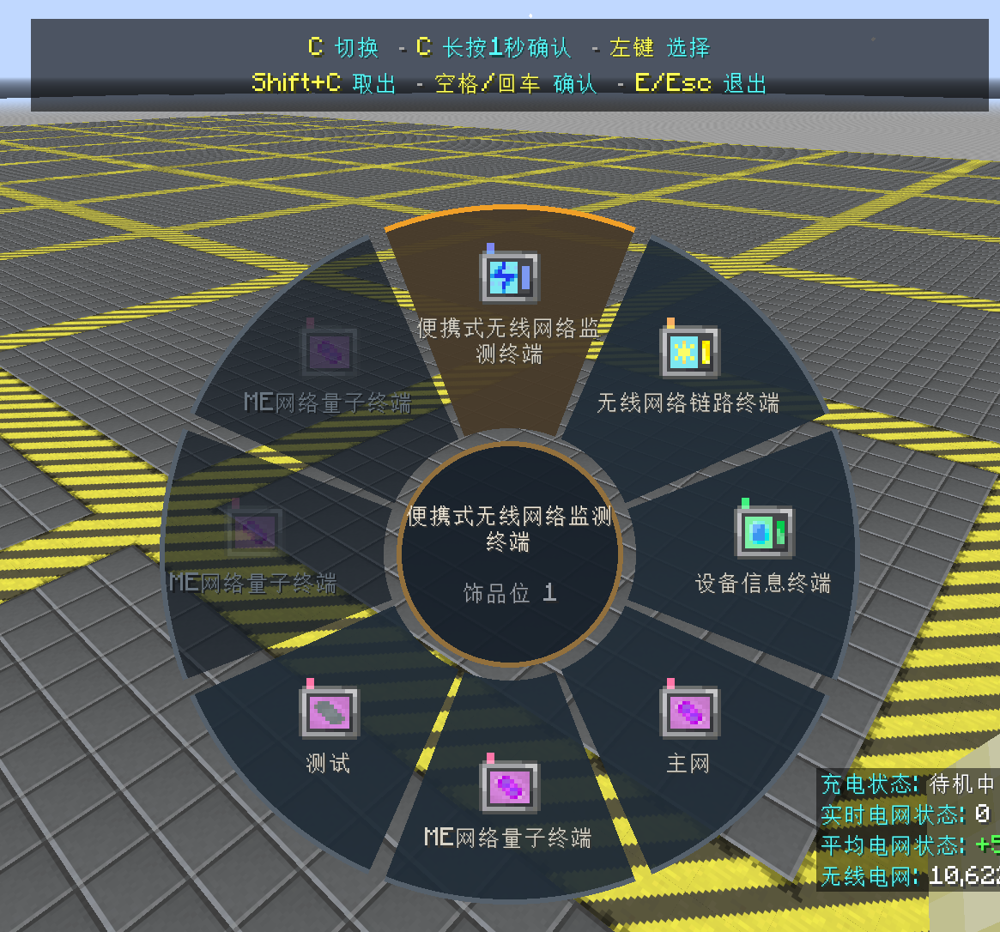 <em>实机图；当前长按确认 0.5 秒 / In-game screenshot; current hold-to-confirm time: 0.5s</em>

四类专属 Baubles 槽共 **8 格：监测 1 + 链路 1 + 设备 1 + 量子 5**。轮盘按饰品库存顺序仅识别前 **1/1/1/5** 个对应终端，多余同类不参与选择。保留物品染色与自定义名称，便于区分多个量子网络。

Four dedicated Baubles types provide **8 slots: 1 Monitor + 1 Link + 1 Device + 5 Quantum**. The wheel recognizes only the first **1/1/1/5** matching terminals in Baubles inventory order. Item colors and custom names help distinguish quantum networks.

| 默认操作 / Default input | 行为 / Behavior |
|---|---|
| C（手持终端 / holding a terminal）| 有有效借出凭据则归还原饰品槽，否则装备到空的专属槽 / Return a valid borrowed terminal to its origin; otherwise equip into an empty dedicated slot |
| C（其他情况 / otherwise）| 首次短按只打开八格轮盘 / First tap only opens the eight-sector wheel |
| 后续短按 C 松手 / Subsequent tap and release C | 轮切；长按 **0.5 秒**确认（含首次）/ Cycle; hold **0.5s** to confirm, including the opening hold |
| 左键、Enter 或 Space / Left-click, Enter or Space | 确认当前选择；监测/设备打开信息 UI，链路/量子取到手中 / Confirm: Monitor/Device opens its info UI; Link/Quantum moves to hand |
| 轮盘 Shift+C / Shift+C in wheel | 强制取到手中，包括监测/设备终端 / Force selected terminal into hand, including Monitor/Device |
| E（背包键）或 Esc / Inventory key or Esc | 关闭轮盘；轮盘期间屏蔽游戏操作，关闭后须松开按键再操作 / Close; gameplay input is blocked in the wheel and must be released before resuming |

取手时原手持物品移到空背包格；无空位可安置时拒绝取出。借出凭据只认原热栏格中的同一物品，归还要求当前选中该格且原饰品槽为空，切走再切回仍可归还；移走、丢弃或替换后不能据此自动归还，每次仅保留一笔借出。

Taking a terminal moves the held item to an empty inventory slot; it is refused if no space is available. One outstanding return record tracks the same item in its original hotbar slot. Return requires selecting that slot and an empty origin Baubles slot; switching away and back is allowed. Moving, dropping or replacing the item invalidates that return path.

## 无线链路终端与覆盖板 / Wireless Energy Tap & Covers

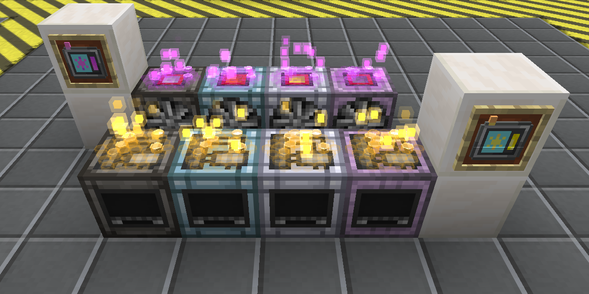

将机器接入跨维度共享的无线 EU 电网。Shift+右击切换**能源**（从电网取电）与**动力**（经容量缓冲池向电网回传，类似虚拟导线），动态纹理标识模式。绑定激光源仓/靶仓消耗 **1 根激光真空管**。

Connect machines to the cross-dimensional wireless EU grid. Shift+right-click switches **Energy** (draw) / **Power** (return through a capacity buffer, like a virtual cable); textures show the mode. Binding a Laser Source/Target Hatch costs **1 Laser Vacuum Pipe**.

| 操作 / Control | 效果 / Effect |
|---|---|
| 右击机器 / Right-click machine | 自动安装对应节点覆盖板，无单独配方；裸覆盖板无配置不能工作 / Install configured node cover, no separate recipe; unconfigured covers do not work |
| Alt+右击空气 / Alt+right-click air | 打开终端界面 / Open terminal UI |
| Alt+Shift+对空气长按右键约 1 秒 / Hold Alt+Shift+right-click air ~1s | 当前模式节点显形 15 秒并报告数量；15 秒内再扫同时显示两类 / Reveal current mode for 15s and report count; rescan within 15s for both modes |
| Shift+右击覆盖板 / Shift+right-click cover | 仅电流可编辑，最小 0.1 A，其余只读 / Edit amperage only, minimum 0.1 A; other values read-only |
| 扳手左击 + Shift / Wrench-left-click + Shift | 拆除全部覆盖板 / Remove all covers |
| 扳手左击 + Alt / Wrench-left-click + Alt | 静默清除链路节点，其他覆盖板沿用原行为 / Silently clear link nodes; other covers retain normal behavior |

机器区块须加载。能源模式从缓存供电；动力模式收集发电机输出，阻止覆盖面重复向真实导线供电。默认每 **600 tick / 30s** 与电网交互，损耗**下行 15%、上行 0%**，可在 `gtswn_network.cfg` 修改；拆除不掉落节点，剩余缓存按上行损耗退回电网。

Machine chunks must stay loaded. Energy powers from buffer; Power collects generator output and blocks duplicate cable output on that face. Default grid interval: **600 ticks / 30s**; losses: **15% down, 0% up**, configurable in `gtswn_network.cfg`. Removal drops no node and refunds the buffer with uplink loss.

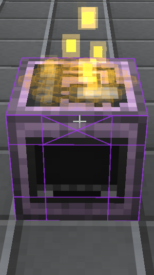 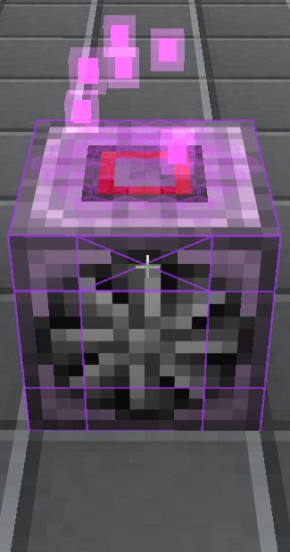 <em>GT 机器九宫格：能源黄、动力紫 / GT machine 3×3 grid: Energy yellow, Power purple</em>

- **材质与动画 / Materials & animation**：Low/Medium/High 蜂窝由内向外显现，old 系列平面渐显，结束后显示粒子；材质与粒子独立 / Low/Medium/High honeycomb reveals outward; old variants fade as flat surfaces. Particles begin afterward and are independent of material.
- **电压配色 / Voltage colors**：High/Medium 与中心粒子默认用 GT 电压色，覆盖 **25/50/75/100%**，默认 **75%（内三圈）**，粒子半径同比例；外围保留能源金黄/动力紫粉，Low/旧材质不变。终端特效页或 `/gtswn tap voltage on|off`、`/gtswn tap ratio <25|50|75|100>` 调整；配置项 `TapVoltageColorsEnabled` / `TapVoltageColorPercent` / High/Medium and center particles use GT voltage colors by default, with the same radius ratio; outer areas retain Energy gold/Power purple. Low/legacy stay unchanged. Set via Effects, commands above or the named config keys.

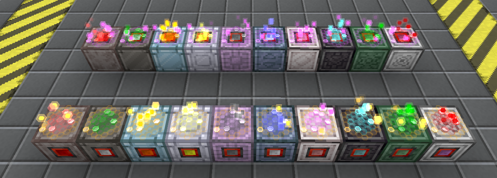

### 配置复制与 MM / Copying & MatterManipulator

`AllowCopyPasteTool` 默认关闭，开启后 GT 覆盖板工具、MM 等可复制节点配置。MM 复制保留绑定与设置，不克隆电量或库存；节点本体免单独材料，侧部件/升级照常计费。在激光仓新装/替换无线覆盖板每面消耗 **1 根激光真空管**，新建量子并入每台消耗 **1 个锚点**，已有有效并入不重复收费。可选无线 EU 补能失败不阻断复制，保留空池或目标原有缓存；批次消息汇总结果与耗材。

`AllowCopyPasteTool` defaults off; enable it for GT cover tools/MM to copy node settings. MM copies bindings/settings, not stored energy or inventories. Node cores require no separate material; side parts/upgrades retain normal costs. A new/replacement wireless cover on a laser hatch costs **1 pipe per face**; new quantum incorporation costs **1 anchor per device**, with no repeat charge for an existing valid incorporation. Failed optional wireless EU refill does not stop copying; the target keeps an empty or existing buffer. Batch messages summarize results and materials.

## ME 量子终端与节点 / ME Quantum Terminal & Node

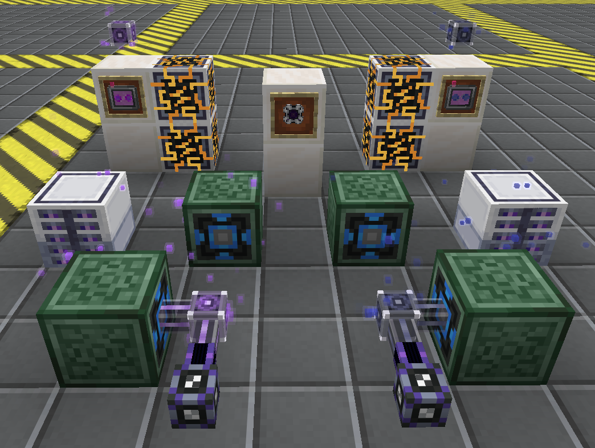

量子终端将成型 ME 控制器整结构量子化并绑定；量子节点经虚拟桥接远程接入，相邻 AE2 设备直接入网，突破线缆距离限制。**LV 工作台配方**：福鲁伊克斯方块 ×4 + LV 发射器 ×4 + ME 控制器 ×1。节点无配方，由绑定终端放置。

Quantize and bind a formed ME controller structure; Quantum Nodes bridge distant adjacent AE2 devices into it beyond cable distance limits. **LV crafting recipe**: Fluix Block ×4 + LV Emitter ×4 + ME Controller ×1. Nodes have no recipe; place them with a bound terminal.

| 手势 / Gesture | 行为 / Behavior |
|---|---|
| 右击控制器 / Right-click controller | 量子化并绑定整结构，已量子化则改绑 / Quantize & bind whole structure; rebind if already quantized |
| Shift+右击控制器 / Shift+right-click controller | 取消量子化并解绑；控制器难挖且防爆，先解除再拆 / Dequantize & unbind; hardened controllers resist mining/explosions, so dequantize before removal |
| 右击空地（已绑定）/ Right-click ground (bound) | 放置量子节点 / Place Quantum Node |
| Shift+右击节点 / Shift+right-click node | 仅移除核心，不掉落；侧部件保留在还原的线缆宿主上 / Remove core without drop; side parts remain on restored cable host |
| Shift+右击空气 / Shift+right-click air | 打开终端 UI / Open terminal UI |
| Alt+右击完整 AE 方块或支持的 GT 仓室 / Alt+right-click full AE block or supported GT hatch | 消耗 1 个量子并入锚点接入绑定网络；再次操作解除 / Incorporate into bound network for 1 anchor; repeat to remove |
| Alt+Shift+右击方块 / Alt+Shift+right-click block | 取消方块目标操作，不并入 / Cancel block-targeted action; no incorporation |
| Alt+Shift+对空气长按右键 1 秒 / Hold Alt+Shift+right-click air 1s | 当前网络显形 15 秒；同终端/维度/网络在期间再用，显形附近全部量子网络，仅已加载区块 / Reveal current network for 15s; repeat with same terminal/dimension/network during reveal for all nearby networks, loaded chunks only |

### 终端界面与供给 / Terminal UI & Supplies

量子与链路终端共用「详情 / 特效」双页 UI，`E`（背包键）/`Esc` 关闭。量子详情含节点、并入、频道信息与 **16 色**网络调色；同网同步，终端仅中心粒子变色，节点/连接边缘/并入粒子/显形框随网变色。链路详情显示玩家、维度、等级、团队负责人、电网 EU。特效页与 `/gtswn quantum`、`/gtswn tap` 共用客户端设置；数值左增右减，范围同命令。

Quantum/Link terminals share Details/Effects pages; close with inventory key/`Esc`. Quantum Details shows nodes, incorporation, channels and **16 network colors**, synchronized across the network: terminal center particles, node rims, incorporation particles and reveal outlines follow the color. Link Details shows player, dimension, level, team lead and grid EU. Effects shares client command settings; left/right-click increases/decreases values within command ranges.

两终端共享按玩家持久保存的个人耗材库：激光真空管/量子并入锚点各最多 **640**，支持快捷存取，单次最多取 **64**、右键取 **1**；角标显示总数，空槽显示虚影。操作前有预装库存时，成功消息显示余量（含用尽后的 0）；失败、解除、无预装库存不提示余量。

Both terminals share player-persistent stores of up to **640 each** of Laser Vacuum Pipes/Quantum Incorporation Anchors. Quick transfer supported; withdraw at most **64**, or **1** with right-click. Badges show totals; empty slots show ghosts. Successful operations that started with preloaded stock report remaining stock, including 0; failures, removals and operations without preloaded stock omit it.

量子终端「命名」支持最多 **40 字符**（含中文），留空恢复默认，无经验/材料成本；Enter 确认、Esc 取消，保留页面与供给槽。

Quantum Rename accepts **40 characters**, including Chinese; blank restores default, with no XP/material cost. Enter confirms, Esc cancels; current page and supply slots stay intact.

### 量子网络安全 / Quantum Security

- **默认 OFF**，控制器保存并同网同步；旧存档无属性也 OFF。配对不自动开启，OFF 时不限制量子访问 / **OFF by default**, including old saves; saved by controller and synced. Pairing does not enable security or restrict access while OFF.
- 网络拥有者或 AE **SECURITY** 权限者可在详情页开关；仅 BUILD 不够。开启后立即要求安全配对及 AE 权限，与历史配对无关。管理者未配对也能改开关，但配对前只能看安全开关，不能看受保护详情 / Owner or AE **SECURITY** permission required to toggle; BUILD is insufficient. Enabling immediately requires pairing and AE permissions, regardless of pairing history. Unpaired managers may toggle but cannot view protected details.
- OP 4/控制台：`/gtswn safety off|on` 立即临时放开/恢复各网络策略，保存 `config/gtswn/gtswn_ae.cfg` → `ae2.quantumSafetyEnabled`（默认 true）。保留配对和单网设置，重开不把 OFF 网络变 ON；全局关闭时不可改单网开关 / OP 4/console: global override applies and saves immediately, preserving pairings and per-network policy. Re-enabling leaves OFF networks OFF; per-network toggles are unavailable during global bypass.

### 节点、并入与负载 / Nodes, Incorporation & Load

| 项目 / Feature | 行为与限制 / Behavior & Limits |
|---|---|
| 连接 / Connection | 致密容量 **32 频道/连接**，节点本身不占频道 / Dense capacity: **32 channels/connection**; node uses none |
| 跨维度 / Cross-dimension | 支持；锚点维度和区块须已加载，节点不主动加载 / Supported; anchor dimension/chunk must already be loaded; no force-loading |
| 节点拆除 / Node removal | 普通机器硬度；可挖掘、AE/GT 扳手 Shift+右击、IC2 原生扳手。核心不掉落，部件及库存回收；不显示 GT 九宫格，保留正常核心/侧部件选框 / Normal hardness; mine or use AE/GT sneak-wrench or native IC2 wrench. No core drop; parts/inventories recovered. Normal core/part outlines, no GT rotation grid |
| 并入对象 / Incorporation targets | 完整 AE 方块、支持 ME 的 GT 仓室；排除线缆/总线等部件及控制器。保留原方块、功能、库存 / Full AE blocks and ME-capable GT hatches; excludes cable/bus parts and controllers. Original block/functions/inventory retained |
| 并入隔离 / Isolation | 阻断物理 AE 连接防串网，保留防爆；原设备挖掘/扳手/掉落不变，拆除自动清理连接 / Blocks physical AE links to prevent merging; retains explosion protection. Native mining/wrench/drops preserved; removal clears connection |
| 节点耗电 / Node power | 默认实际 **10 AE/t**，`quantumNodeIdlePowerUsage` 可配 / Default actual **10 AE/t**, configurable |
| 并入附加费 / Incorporation surcharge | 每个有效连接额外实际 **50 AE/t**，不含设备/频道原生耗电；`gtswn_ae.cfg` 的 `quantumIncorporationIdlePowerUsage`，重启应用。解除/失效/区块卸载释放，缺电仍保留需求 / Extra actual **50 AE/t** per valid link, excluding native device/channel power; configure named key, restart to apply. Released on removal/invalidation/chunk unload; unpowered grids retain demand |

节点与并入费抵消 AE 耗电倍率，实际分别为 10、额外 50 AE/t；设备与频道仍按 AE 原生倍率计费。

Node/incorporation charges compensate AE's power multiplier to draw 10/extra 50 AE/t; native device/channel power retains AE's multiplier.

**锚点配方 / Anchor recipe**：LV 组装机每批 **16**：基础涂层电路板 ×1、LV 发射器 ×1、LV 传感器 ×1、钢板 ×2、末影珍珠 ×1、细铜线 ×4 / LV assembler → **16**: Basic Coated Circuit Board ×1, LV Emitter ×1, LV Sensor ×1, Steel Plate ×2, Ender Pearl ×1, Fine Copper Wire ×4.

**过载 / Overload**：95% 容量聊天警告；量子节点带入频道超控制器容量时倒计时 **3 分钟**，恢复即取消，否则控制器结构**爆炸**。AE2 无限频道不受此限 / Chat warns at 95% capacity. Excess node channels start a **3-minute** grace timer; restoring capacity cancels it, otherwise the controller structure **explodes**. Exempt with AE2 infinite channels.

## 便携无线监测终端 / Portable Wireless Network Monitor

背包或 Baubles 中显示电网 HUD；普通右击空气首次绑定自己，之后循环关闭/常规/科学计数。Shift+右击自己的终端或默认 **H**（可改键）打开远程查看与设置；Shift+右击未绑定/他人终端改绑自己。普通右击信息屏可绑定最多 **16 块**，随身查看完整原生内容。

Inventory/Baubles provides a grid HUD. Right-click air binds yourself first, then cycles Off/Normal/Scientific. Shift+right-click your own monitor or press default **H** (rebindable) for viewer/settings; Shift+right-click unbound/borrowed monitors rebinds ownership. Right-click info panels to bind up to **16** and view full native content remotely.

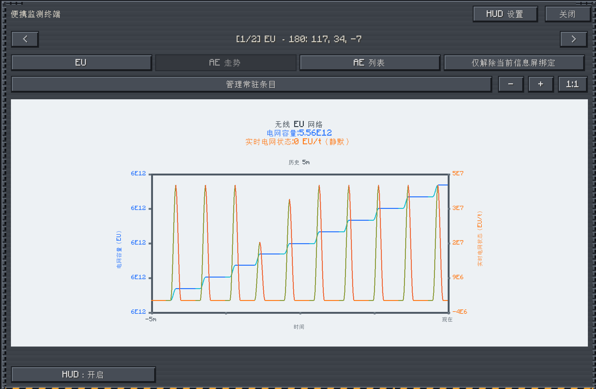 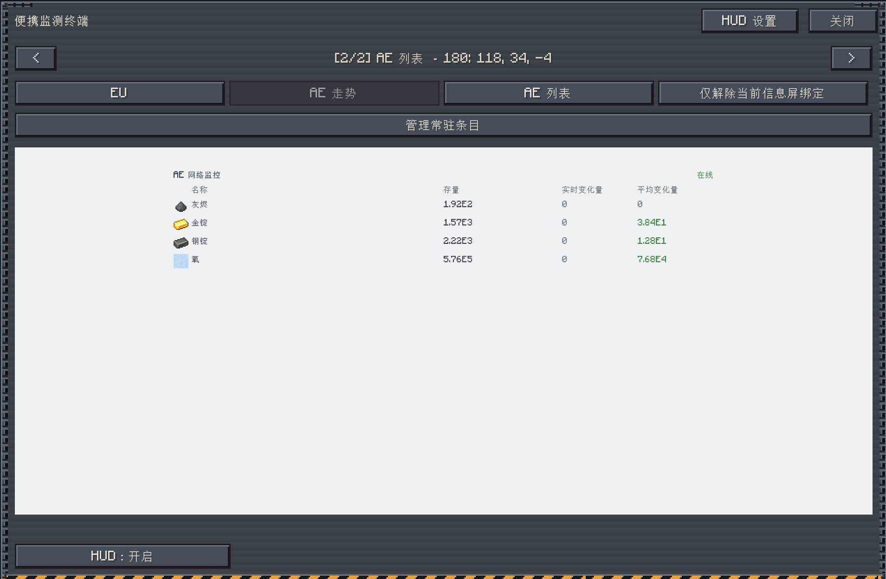 <em>原生走势与库存随身查看 / Native charts and inventory on the go</em>

- **真实来源 / Sources**：EU/AE 走势/AE 库存按钮选择对应模式的真实绑定屏，前后逐屏切换，解绑仅当前屏；保留原屏计数法、时间窗、走势色。查看/设置/挂载页缩小 15%，适配屏幕并保留边距，完整图表与分页列表可用 / Shortcuts select bound physical panels of the matching mode; browse individually and unbind only the current panel. Formats/windows/colors remain. Viewer/settings/pins are 15% smaller, fit the screen with margins, and retain full charts/pagination.
- **常驻 / Pins**：标题、简图、数字独立勾选，与概览/充电状态共存；EU 电量/瞬时/平均分行，同屏走势只算一个轮换组，分组标题“EU走势 / AE走势” / Select titles, plots and values independently alongside overview/charging. EU/instant/average use separate lines, but one screen counts as one rotation group, headed EU Trend/AE Trend.
- **AE 库存 / AE stock**：物品/流体独立勾选即时/平均，均选仍一行，即时在前、横杠分隔、无字段标签；平均 **5 分钟**。顺序为 `[库存] → 图标 → 名称、存量、变化率` / Separate Instant/Average selections per item/fluid; both share one row, instant first, dash-separated without field labels. Average: **5m**. Order: `[Stock] → icon → name, stock, rates`.
- **布局 / Layout**：偏移、缩放、宽度、常驻组数、轮换时间、刷新间隔、文本/卡片/曲线可调；独立开关充电、电量、瞬时、平均、电压级、AE 数量/变化率；原 HUD 命令仍可用 / Adjust offsets, scale, width, pin count, rotation, refresh and Text/Card/Curve styles. Toggle charging, EU, instant, average, voltage tier, AE amount/rate; HUD commands remain available.

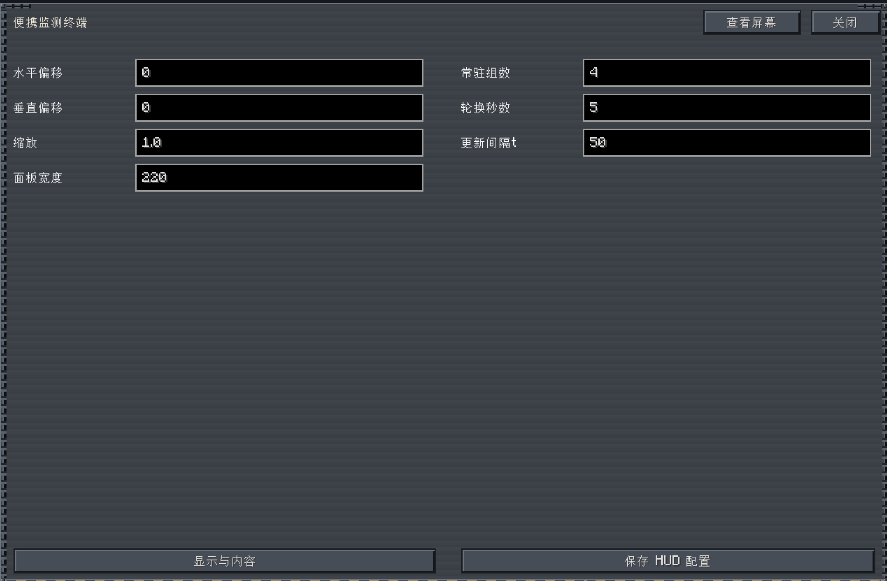 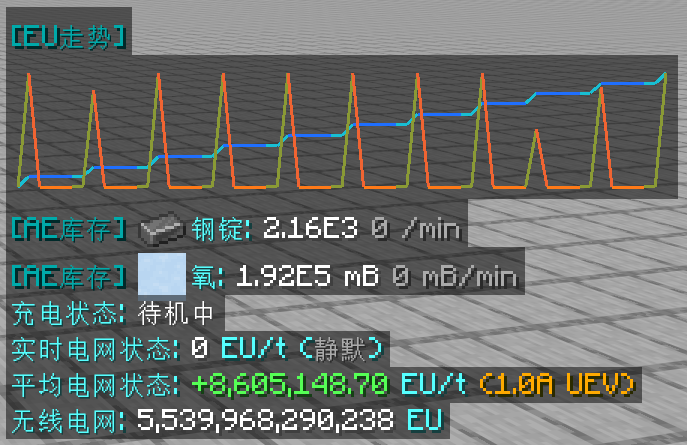 <em>HUD 布局设置与实际显示 / HUD settings and display</em>

### 电池与充电 / Battery & Charging

- **安装/替换 / Install/replace**：终端 + 兼容 GT/IC2 电池无序合成，继承新电池电量，旧电池带终端余电返还，满包则掉落；无独立终端变种 / Shapeless terminal + compatible GT/IC2 battery retains new battery charge; old battery returns with remaining terminal energy, dropping if full. Same terminal, no variants.
- **充电 / Charging**：背包/饰品栏中每 **10 秒**从绑定电网补缓存并计下行损耗，按电池电压级对背包/装备/饰品电力物品每目标 **1A** 充电；HUD 显示缺缓存/待机/充电/完成 / Refill from bound grid every **10s** with downlink loss; charge inventory/armor/accessories at battery-tier **1A per target**. HUD: empty/standby/charging/complete.
- **工具箱 / Toolboxes**：带电池终端每 **20 tick** 轮转最多 **2 箱**，给支持的 GT 箱内电力工具充电；箱内电池槽沿用原路径。箱 UI 打开/破损动画/玩家挥动时跳过，不递归嵌套箱 / Battery-equipped monitor charges supported electric tools in up to **2 GT toolboxes per 20 ticks**, rotating. Battery slots retain original path. Skip open GUI/damage animation/player swinging; no nested traversal.
- **拆卸/查看 / Remove/inspect**：带电池终端 + GT5U 撬棍无序合成取回带余电电池。NEI 有小型锂电池装/拆示例；GT/IC2 原生 Tooltip 和电量条显示缓存，充电更新不打断手持工具 / Shapeless battery-equipped terminal + GT5U crowbar returns charged battery. NEI shows small-lithium install/removal examples. Native energy tooltips/bars show buffer; updates preserve held-tool use.

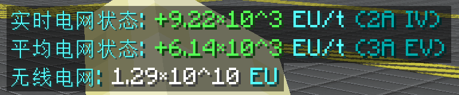 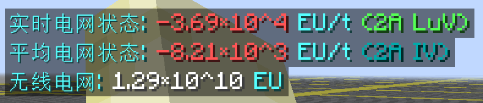 <em>科学计数 HUD：充电 / 放电 / Scientific HUD: charging / discharging</em>

## 无线能量监视器与红石 / Wireless Energy Monitor & Redstone

单方块机器每 **5 秒**更新电网状态，可按储量或电网状态控制红石并动态切换状态贴图，支持工业信息屏。常规/科学计数（1,234,567 EU / 1.235×10^6 EU），变化率可用 GT 安培+电压级显示（如 2A HV）。

Single-block monitor updates every **5s**, controls redstone by grid energy/status with dynamic state textures, and connects to Industrial Information Panels. Normal/scientific formats; GT-style amperage/voltage rates (e.g. 2A HV).

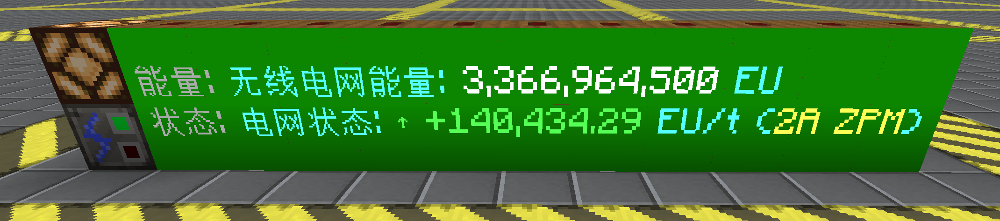 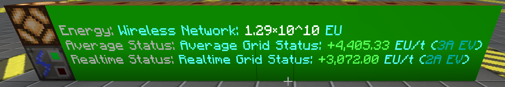  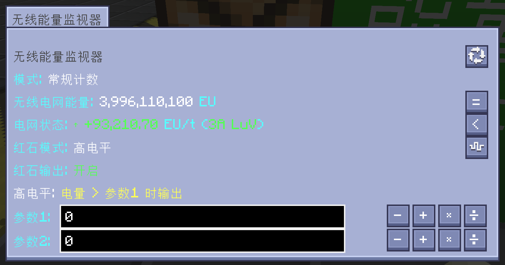 <em>监视器与中英界面 / Monitor and bilingual UI</em>

| 模式 / Mode | 红石输出 / Redstone output |
|---|---|
| 关闭 / Off | 无 / None |
| 高电平 / High | EU > 阈值 / threshold |
| 低电平 / Low | EU < 阈值 / threshold |
| 正向滞后 / High-Hysteresis | EU > 参数1时输出，EU < 参数2才取消 / On above param1; off only below param2 |
| 反向滞后 / Low-Hysteresis | EU < 参数2时输出，EU > 参数1才取消 / On below param2; off only above param1 |

**电网读数 / Grid readings**：监视器/便携终端显示储量、瞬时变化率、窗口平均（默认 **300 秒**）；近零为 `<1EU`、静默/长期静默，表示电网净变化而非单机功率 / Monitors show energy, instant rate and window average (**300s** default); near zero: `<1EU`, Silent/Long-Term Silent. These measure net grid change, not individual machine power.

## 网络信息屏与拓展屏 / Network Info Panel & Extender

主屏+自动附着的拓展屏组成连续填充矩形，显示无线电网走势；同玩家 UUID 的 EU 屏共享历史。八个窗口 **5m / 1h / 8h / 24h / 7d / 1M / 3M / 1Y**。可调背景、线色/宽、平滑度、字号，支持常规/科学/公制计数（默认科学）。EU 储量/变化率可设平直/上升/下降分区色，并同步便携查看与 HUD 简图。

Main panel + auto-attaching extenders form a filled rectangle. EU panels share history by player UUID, with eight windows: **5m / 1h / 8h / 24h / 7d / 1M / 3M / 1Y**. Configure background, lines, smoothing and text; Normal/Scientific/Metric formats (Scientific default). Flat/rising/falling EU energy/rate colors carry into portable views and HUD mini charts.

    <em>信息屏与矩形拓展 / Info panels and rectangular extension</em>

| AE 模式 / AE mode | 内容与操作 / Content & Controls |
|---|---|
| 走势图 / Chart | 手持物品/流体右击绑定；蓝左轴存量、橙右轴变化率（同 EU/t 线色）；八时间窗、可缩放简报显示存量/实时/平均，`+/-` 调字号、时长按钮换窗口。可设 Y 轴界限、线宽/色/可见性、样条平滑、背景 / Right-click with item/fluid to bind. Blue left axis: stock; orange right: rate (EU/t line color). Eight windows; brief shows stock/instant/average, `+/-` resizes text, span button switches window. Configure axis limits, line width/color/visibility, smoothing/background |
| 实时监测 / Realtime | 手持物品/流体右击添加多个监视项；图标、名、存量、实时与 **300s** 平均。滚轮/拖拽/滚动条，另有可调格大小的紧凑模式；字号/加粗/图标大小可配，深绿文字表示在线且被监视 / Add multiple items/fluids by right-click. Icon/name/stock/instant/**300s** average, wheel/drag/scrollbar; compact grid with configurable cells. Set font/bold/icon size; deep green means online and monitored |

  <em>AE 走势与实时库存 / AE trends and realtime stock</em>

## 设备信息终端 / Device Info Terminal

绑定支持的 GT 工作机器，列表显示运行/待机/停机、实际 EU 输入/输出、瞬时/平均 EU/t、位置及配方；支持排序、四种计数法、跟踪/忽略、改名、热图与经验传送。

Bind supported GT working machines for status (Running/Idle/Stopped), actual EU in/out, instant/average EU/t, location and recipes; sorting, four number formats, tracking/ignored, names, heat view and XP travel.

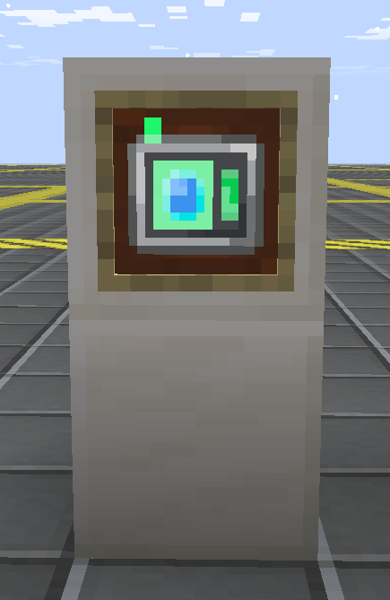 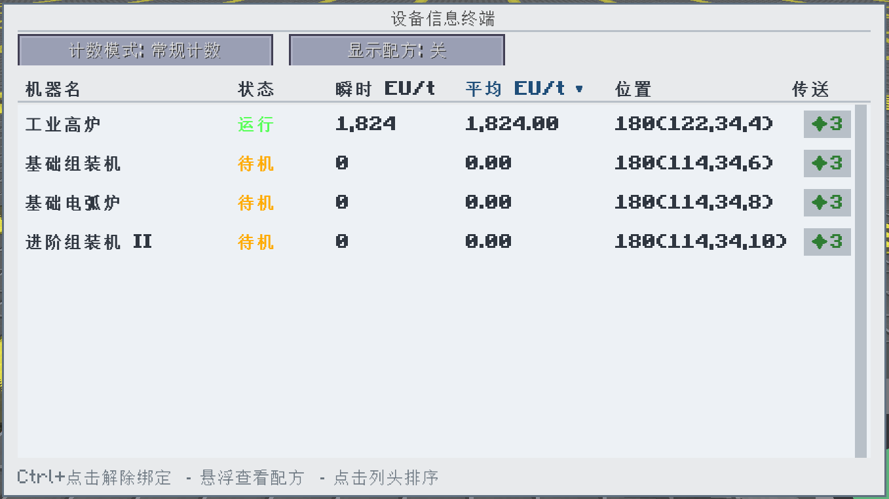

| 手势 / Gesture | 行为 / Behavior |
|---|---|
| 可视化关闭时右击工作机器 / Right-click machine, visualization off | 绑定；携带终端放置支持机器时自动绑定 / Bind; supported machines placed while carrying terminal auto-bind |
| 右击空气，或可视化开启时右击 / Right-click air, or with visualization on | 可视化瞄准已绑定机器/标记则传送，否则开列表 / Travel to aimed bound machine/marker in visualization; otherwise list |
| Shift+右击机器 / Shift+right-click machine；Shift+点击行 / Shift+click row | 本终端切换跟踪/忽略；未绑定只记偏好 / Toggle tracking/ignored for this terminal; unbound only records preference |
| Shift+右击空气/非机器 / Shift+right-click air/non-machine | 设置 / Settings |
| Alt+长按右键约 1 秒（可瞄准方块）/ Hold Alt+right-click ~1s (blocks allowed) | 蓄满立即扫描当前维度已加载的本人/团队机器；重复蓄力不取消 / Scan own/team machines in current dimension's loaded chunks on charge completion; repeating does not cancel |
| Shift+Alt+右击 / Shift+Alt+right-click | 切换并保存可视化 / Toggle/save visualization |
| Alt+左击列表名称 / Alt+left-click list name | 改名、颜色、加粗，应用于世界标签 / Name/color/bold, also for world labels |
| Ctrl+点击行 / Ctrl+click row | 远程解绑，无确认 / Remote unbind, no confirmation |
| 行内 ✦ / Row ✦ | 传送；默认 **1 级经验**，冷却 **10 tick / 0.5s** / Travel; default **1 XP level**, **10-tick / 0.5s** cooldown |

- **采样/配方 / Sampling/recipes**：`deviceSampleIntervalSeconds` 默认 **10s**；平均为 **60 点**滚动值，瞬时取最新点。悬浮名称预览可读取配方，“显示配方”可放入列表 / Default **10s** sampling, **60-point** rolling average, latest sample for instant. Hover names for available recipe; Show Recipe puts it in list.
- **能量口径 / Energy scope**：实际 EU 消耗/产出含直接无线交易；小图标标链路输入/输出/双向。耗电负数；聚变只计控制器自身消耗，等离子发电计下游 / Actual EU includes direct wireless transactions; icons mark link input/output/both. Consumption negative; fusion counts controller draw, plasma generation downstream.
- **忽略 / Ignored**：仅影响本终端；储能/变压器默认忽略。普通扫描跳过；完成 **15 秒**内同终端再蓄力可纳入，仍忽略并灰色零值 / Per-terminal only; storage/transformers default ignored. Scans skip them; recharge same terminal within **15s** after completion to include them, retaining ignored/gray-zero state.
- **常驻可视化 / Visualization**：开启有附魔光，背包中仍显示已绑定锚点；名称/状态/实时 EU/配方标签可单独开关，传送须手持对应终端 / Glint marks enabled state; bound anchors persist in inventory. Toggle name/status/live EU/recipe labels separately; hold matching terminal to travel.
- **热图 / Heat view**：耗电暖红、发电绿，半径随瞬时/平均负载加权平滑变化；范围、不透明度、遮挡、设备/标签上限可配。热图倍率 **1–1000，默认10**（原半径上限 10 倍），标签 **1–100，默认10**（原大小 150%）/ Red consumption, green generation; smooth weighted instant/average radii. Configure range, opacity, occlusion, device/label limits. Heat multiplier **1–1000, default 10** (10× original radius limit); labels **1–100, default 10** (150% original).
- **安全传送 / Safe travel**：机器前/上方选离玩家最近的安全落点，飞行可无地面；落点有效且传送成功才扣经验 / Nearest safe candidate in front/above machine; flying permits unsupported air. XP charged only on successful valid travel.
- **配置 / Configuration**：默认最多 **1024** 绑定，已有配置保留；单人本地保存，多人 OP 在全服页保存服务端配置并同步在线玩家，费用可设 **0**。两端版本须一致 / Default **1024** bindings; existing config retained. Singleplayer saves locally; multiplayer OP Server-tab edits save server config/sync online players. Cost **0** allows free travel; match client/server versions.

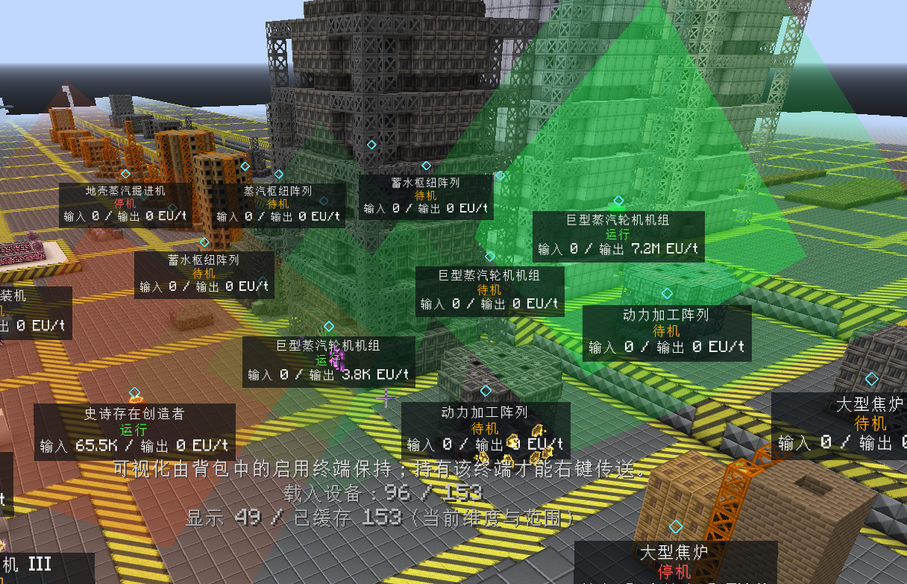 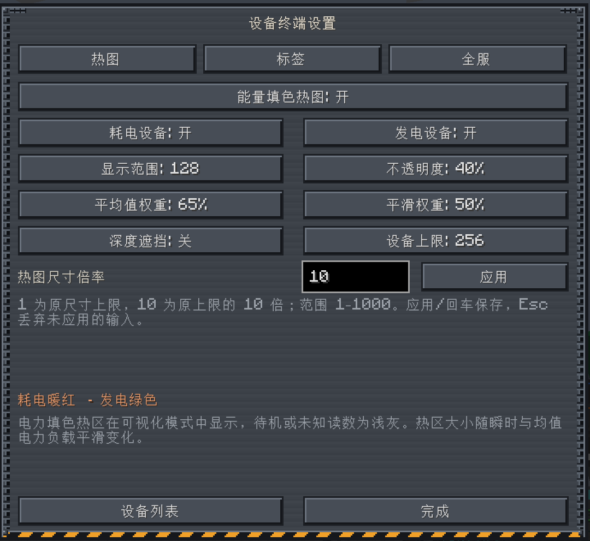 <em>设备可视化与设置 / Device visualization and settings</em>

**LV 有序配方（v1.7.8 起）/ LV shaped recipe (since v1.7.8)**：LV 传感器 / Sensor ×2 + LV 发射器 / Emitter ×2 + 钢板 / Steel Plate ×3 + 电脑屏幕覆盖板 / Computer Screen Cover ×1 + 末影珍珠 / Ender Pearl ×1 → 设备信息终端 / Device Info Terminal ×1。

## 工厂模式与自定义仪表盘 / Factory Mode & Custom Dashboard

从工厂全景到单台设备，将电网、机器、资源和信息屏集中到自己的监控界面。/ Bring grids, machines, resources and info panels into one workspace, from a factory overview to individual devices.

- **自由观察 / Free camera**：默认 F12 打开工厂模式，平移、旋转、缩放视角，查看设备状态与能耗热图；搜索设备和网络节点，快速定位目标。/ F12 opens Factory Mode by default; pan, rotate and zoom, inspect machine status and energy heatmaps, and search for machines or network nodes to locate them.
- **自定义仪表 / Custom dashboard**：默认 F10 直接打开，四种主题、最多 512 个组件，组合电网、设备、资源、图表与时钟信息；内容超出卡片时可滚轮浏览或拖动滚动条，Ctrl+滚轮缩放画布。/ F10 opens the dashboard by default; combine up to 512 widgets across four themes. Scroll overflowing card content with the wheel or scrollbar, and use Ctrl+wheel to zoom the canvas.
- **读数与图表 / Readings & charts**：支持的卡片可直接切换普通、科学或千位缩写计数；电网净变化可选瞬时或时间窗平均，平均窗口可设 1–3600 秒，并显示 A + 电压等级后缀。/ Supported cards offer Normal, Scientific and Metric notation controls. Grid net change supports instant or averaged readings with a 1–3600s window and an amperage + voltage-tier suffix.
- **来源绑定 / Source binding**：从携带的终端中选择机器、信息屏或 AE 资源，按名称、坐标或来源搜索，并可更换或解除绑定；应用预设时自动尝试使用当前可用来源，仍可手动调整。/ Choose machines, info panels or AE resources from carried terminals; search by name, coordinates or source, then change or clear bindings. Applied presets try available local sources automatically, with manual adjustment afterward.
- **布局编辑与保存 / Layout editing & saving**：Ctrl+拖动框选、Ctrl+点击多选，移动、缩放并设置组件；Ctrl+Z / Ctrl+Y 撤销与重做。手动保存布局，退出时若有未保存修改，可选择保存或放弃。/ Ctrl+drag selects an area and Ctrl+click selects multiple widgets; move, resize and configure them, with Ctrl+Z / Ctrl+Y undo and redo. Save layouts explicitly; leaving with unsaved edits offers save or discard choices.
- **预设拼接与分享 / Preset placement & sharing**：组件库预设和导入布局可覆盖或追加；追加时以轮廓预览定位，左键放置，右键或 Esc 取消。分享码只含外观与布局，不携带原数据源绑定，便于在自己的工厂复用。/ Replace or append library presets and imported layouts. Position the outline preview when appending, left-click to place, or right-click / Esc to cancel. Sharing codes carry visual layouts without the original data-source bindings for reuse in your own factory.

### 工厂模式：设备状态与能源热图集中查看 / Factory Mode: Machine Status & Energy Heatmaps

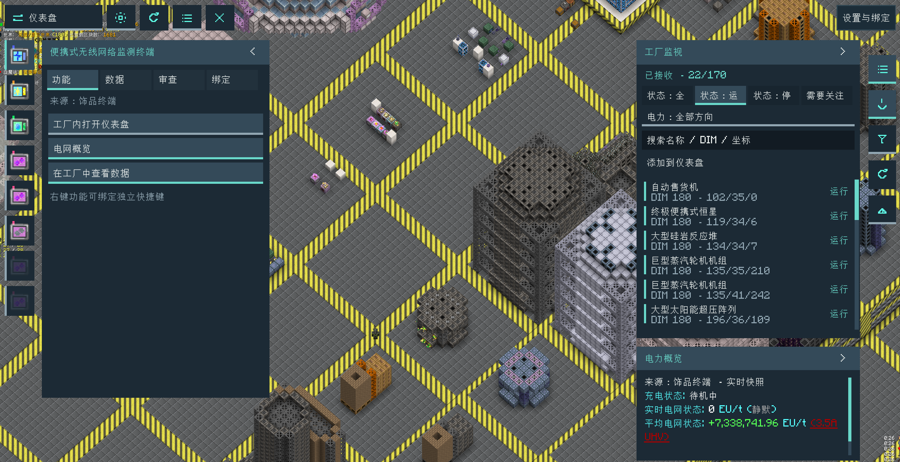

### 工厂全景：从整体布局查看生产现场 / Factory Overview: Explore the Production Floor

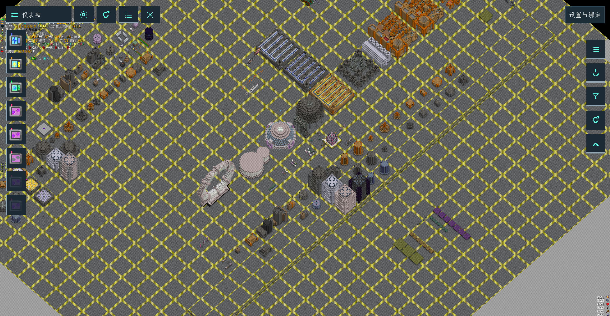

### 自由视角：平移、旋转与缩放观察工厂 / Free Camera: Pan, Rotate & Zoom

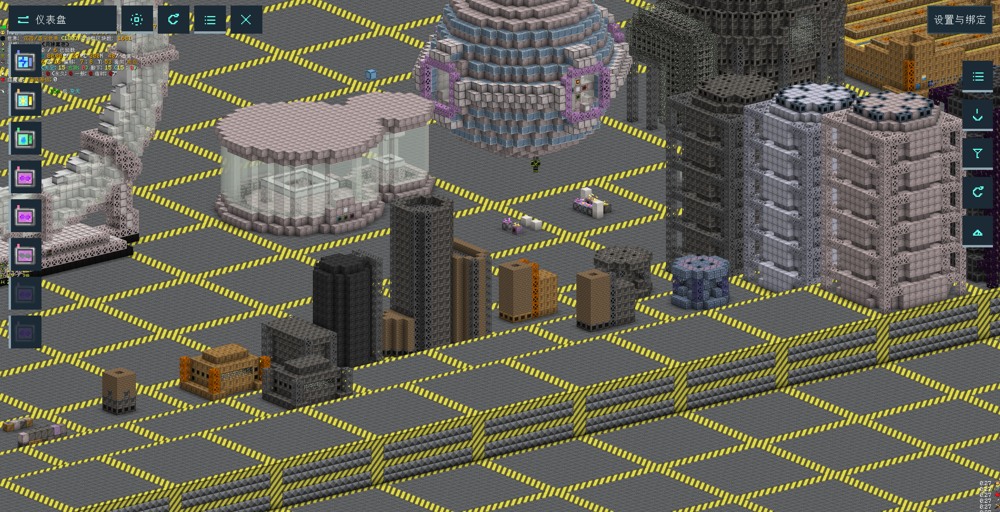

### 自定义仪表盘：把常用监控集中在一处 / Custom Dashboard: Your Monitoring Workspace

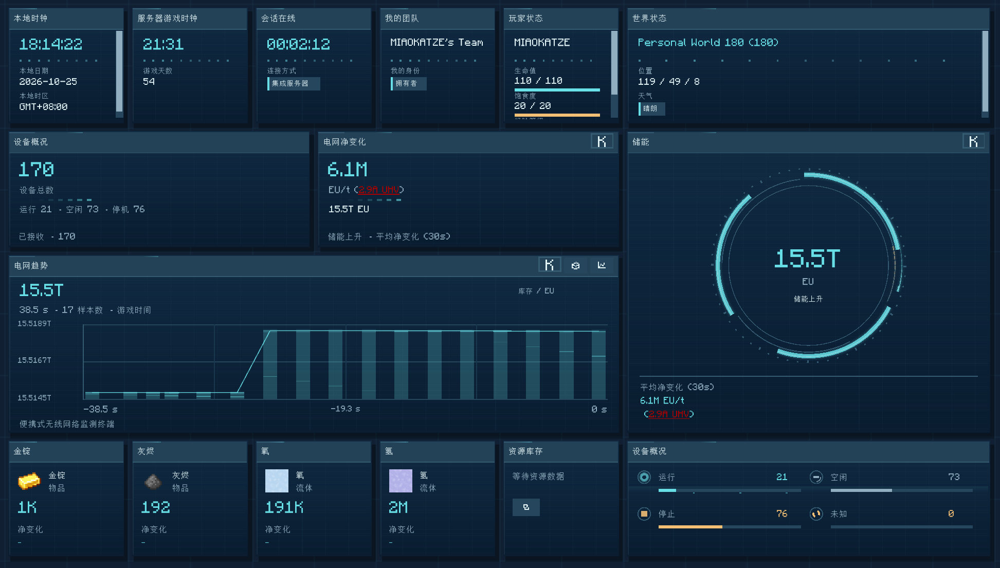

### 四种外观：标准、复古、工业与简约 / Four Themes: Standard, Retro, Industrial & Minimal

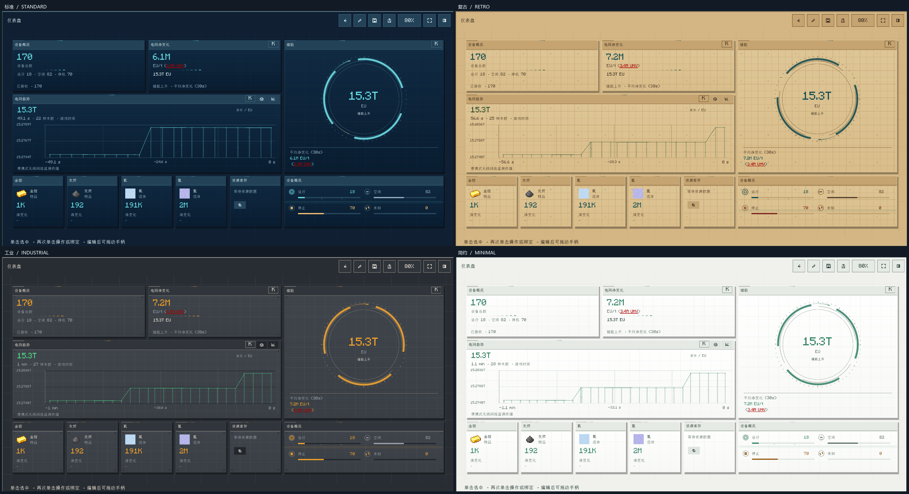

### 自由扩展：组合多种组件与监控内容 / Expand Your Dashboard: Combine Widgets & Readings

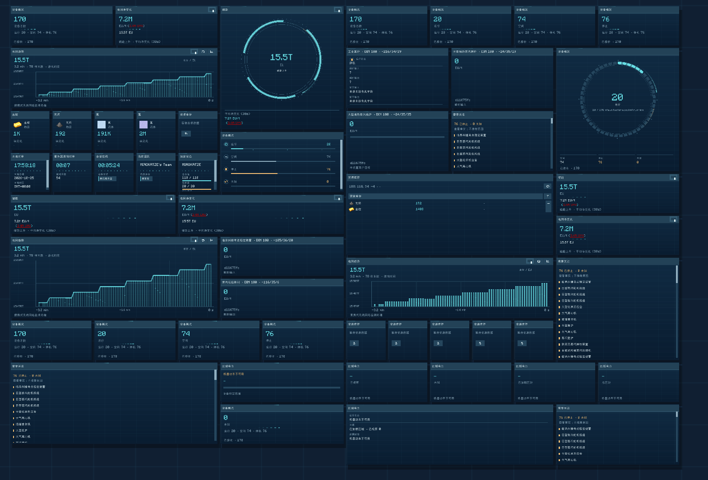

### 组件库与预设：按需选择、自由拼接 / Widget Library & Presets: Choose, Place & Combine

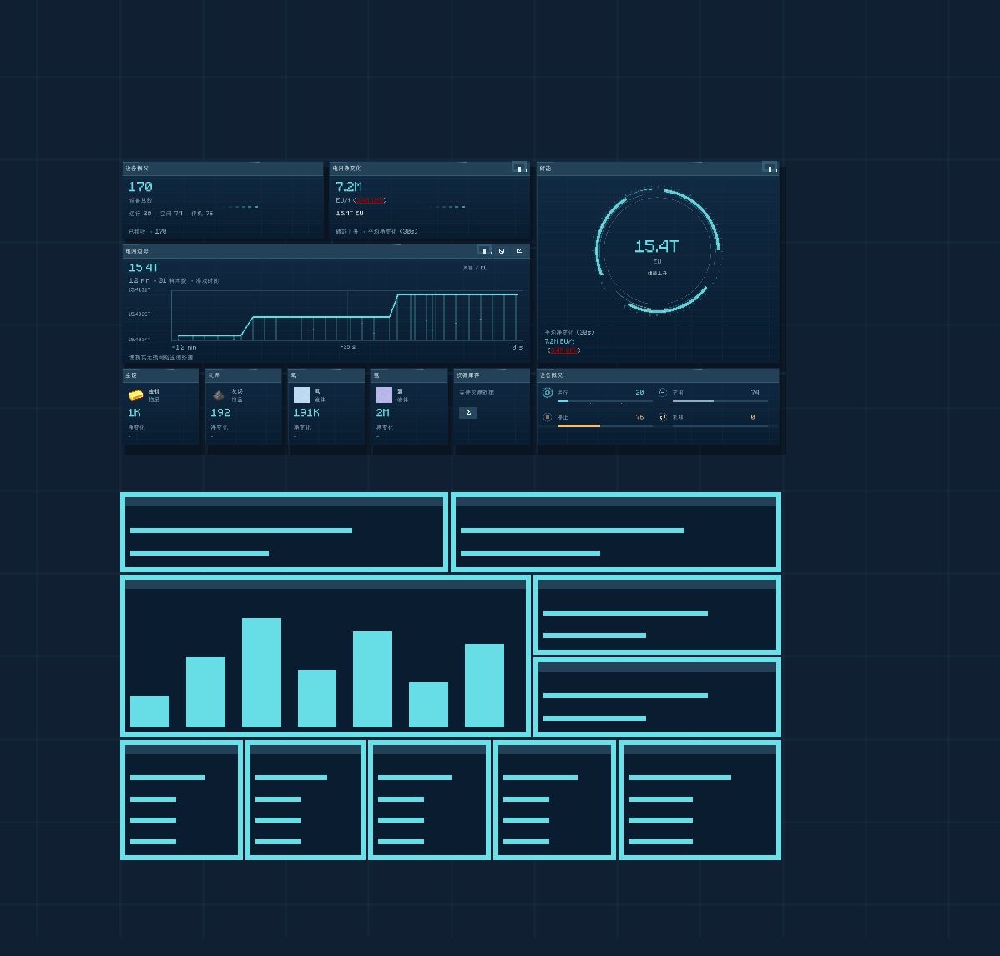

### 预设分享：导出与导入自己的布局 / Preset Sharing: Export & Import Your Layouts

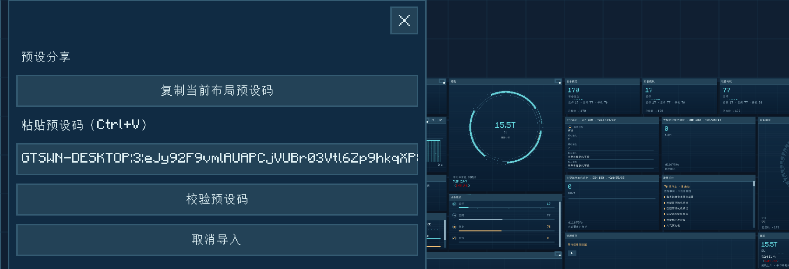

### 组件编辑：调整样式、内容与显示方式 / Widget Editor: Customize Style, Content & Display

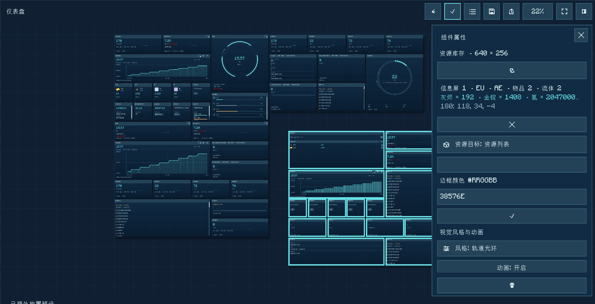

## BQ 任务包 / BetterQuesting Quests

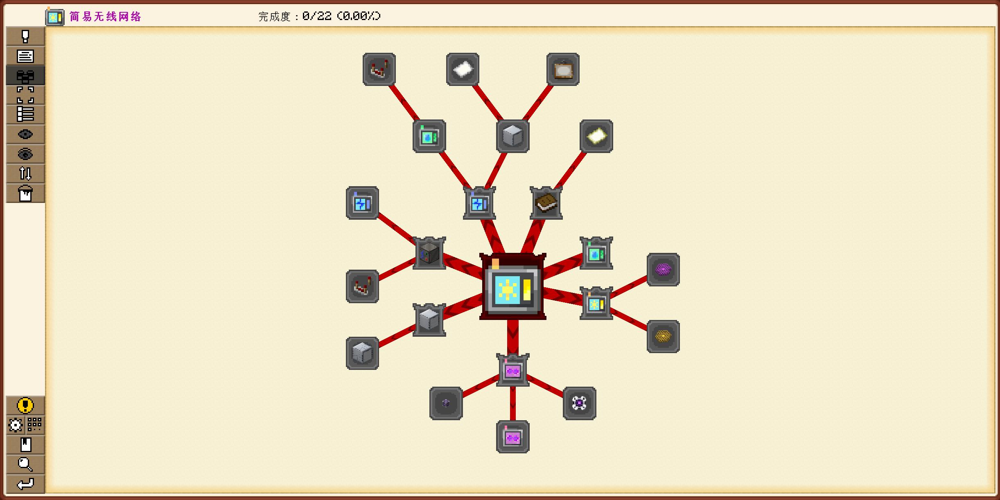

内置中英双语 **简易无线网络 / GT Simple Wireless Network** 任务线，**14 题、全 LV 科技**：监视器/HUD → 链路/覆盖板 → 信息屏 → ME 量子化/锚点/调色及设备终端。描述含屏幕绑定、完整随身查看、AE 即时/平均挂载、设备扫描/可视化、忽略和安全传送/经验设置。自动加载；换 jar 同步旧世界定义、保留进度，任务身份/条件/奖励/前置不变。

Built-in bilingual **14-quest, all-LV** line covers monitors/HUD, links/covers, panels, ME quantization/anchors/colors and device terminals. Guidance includes panel binding, full portable views, AE instant/average pins, device scans/visualization, ignore and safe XP travel. Auto-loads; jar updates refresh existing-world definitions while preserving progress, quest identities/conditions/rewards/prerequisites.

## 命令 / Commands

### 管理员 / Admin

**OP 4**（安全命令也支持控制台 / safety also accepts console）。

| `/gtswn …` | 能力 / Capability |
|---|---|
| `global_energy_trans <fromUUID> <toUUID>` | 一次迁移源网络全部 EU，用于换账号等 UUID 变化 / Transfer all EU once between UUID networks after account/UUID changes |
| `global_energy_join <memberUUID> <leaderUUID>` | 成员无线 EU 网络永久并入队长 / Permanently join member wireless EU network to leader |
| `cleanup_info_data <all\|player>` | 清过期信息屏历史，或指定在线玩家全部历史 / Clean expired panel history, or all history for selected online player |
| `safety <off\|on>` | 全局临时放开/恢复量子安全，保留单网策略，详见上文 / Global quantum safety bypass/restore, preserving per-network policy; see above |

### 客户端 / Client

无需 OP/作弊，仅本地，支持 Tab 补全；带值立即生效并保存 `config/gtswn/gtswn_network.cfg`，偏移/缩放无值显示当前值，HUD 行也可在 `[hud]` 配置。

No OP/cheats; local with Tab completion. Values apply/save immediately to `config/gtswn/gtswn_network.cfg`. Omit offset/scale value to inspect; HUD rows also configurable in `[hud]`.

| `/gtswn …` | 功能、范围与默认 / Function, range & default |
|---|---|
| `HudXOffset [值/value]` / `HudYOffset [值/value]` | 水平/垂直偏移，整数 ±500，Y 正向上 / Horizontal/vertical, integer ±500, positive Y up |
| `HudScale [值/value]` | HUD 缩放 / scale：0.2–5.0 |
| `hud <charge\|eu\|instant\|average> <on\|off>` | 充电/电量/瞬时/平均行 / Charging/energy/instant/average rows |
| `tap` / `quantum` | 链路 / 量子节点及并入特效用法与设置 / Link / quantum node and incorporation effects settings/usage |
| `<tap\|quantum> <on\|off>` | 独立粒子开关，保留材质/动画/数值 / Independent particles; retain material/animation/values |
| `<tap\|quantum> density <0-200>` | 密度 %，默认100；0 停发射 / Density %, default 100; 0 stops emission |
| `<tap\|quantum> size <10-400>` | 大小 %，默认100（此前实际大小150%）/ Size %, default 100 (150% previous physical size) |
| `<tap\|quantum> distance <1-256>` | 格数，默认64；限粒子发射/绘制，tap 也限材质 / Blocks, default 64; bounds emission/drawing, plus tap material |
| `tap material <old\|oldplus\|low\|medium\|high>` | 链路材质，默认high，不改变粒子密度 / Link material, default high; no density change |
| `tap voltage <on\|off>` | High/Medium 电压配色，默认开 / High/Medium voltage colors, default on |
| `tap ratio <25\|50\|75\|100>` | 电压配色比例 %，默认75 / Voltage color coverage %, default 75 |
| `<tap\|quantum> <help\|status\|reset>` | 该组用法/当前值/重置；总 `help/status/reset` 覆盖两组 / Group usage/status/reset; global forms cover both |

| 材质 / Material | 外观 / Appearance |
|---|---|
| `old` / `oldplus` | 16×16 四帧旧覆盖面 / four-frame legacy；oldplus 更复杂 / more detailed |
| `low` / `medium` | 32×32 / 64×64 平面蜂窝 / flat honeycomb |
| `high` | 64×64 立体蜂窝 / honeycomb with surface relief |

首次升级将 `QuantumParticleQuality` / `ParticlesEnabled` 迁移成两组独立配置，保留开关/密度偏好，之后旧项不覆盖新项；分组命令替代旧 `quality` / `particle`。两组默认开启、密度/大小 **100%**、距离 **64**；受客户端粒子预算和原版设置限制，不强制加载区块。

First upgrade migrates legacy quality/toggle preferences into independent groups; old keys stop overriding them, and grouped commands replace `quality` / `particle`. Both default on, **100%** density/size, **64** blocks; client budgets and vanilla particle settings still apply, without force-loading chunks.

## 许可证 / License

[AGPL-3.0](LICENSE)。
